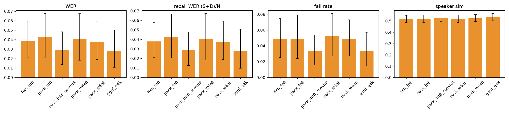
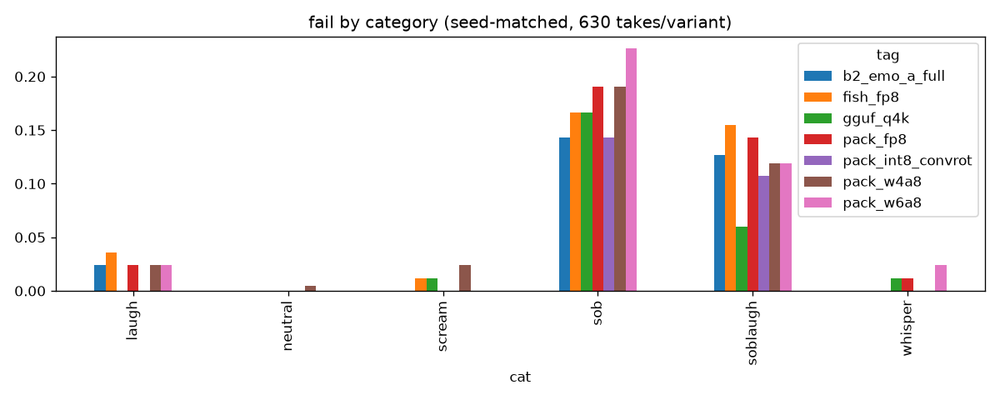

# drama3-quant-bench: does quantization kill Drama 3's emotions?

We benchmarked [Fish Audio Drama 3](https://huggingface.co/fishaudio/drama-3) across quantized builds and runtimes: 30 lines × 3 voices × 7 seeds = **630 takes per variant**, scored automatically for intelligibility, voice match, failures and emotion. We also built **Emo-W4**, a 4-bit variant calibrated on emotional speech, which reduces failures on crying lines.

## Results (seed-matched, 90 items, 95% bootstrap CIs in `results/results.csv`)
| variant | file GB | WER | fail | sob fail | spk-sim | emotion score | RTF |
|---|---|---|---|---|---|---|---|
| ComfyUI-Drama3 FP8 | 38.6 | 0.043 | 0.049 | 0.190 | 0.519 | 0.124 | 0.72 |
| ComfyUI-Drama3 int8 ConvRot | 38.7 | 0.029 | 0.033 | 0.143 | 0.524 | 0.127 | 0.97 |
| ComfyUI-Drama3 W6A8 | 32.7 | 0.041 | 0.052 | 0.226 | 0.518 | 0.116 | 0.89 |
| ComfyUI-Drama3 W4A8 | 24.6 | 0.038 | 0.049 | 0.190 | 0.523 | 0.119 | 0.90 |
| **Emo-W4 (ours, `b2/`)** | 24.8 | 0.031 | 0.039 | **0.143** | 0.533 | 0.118 | 0.92 |
| fish-speech server FP8 | – | 0.039 | 0.049 | 0.167 | 0.518 | 0.112 | 0.43 |
| audio.cpp GGUF Q4_K_S | – | 0.028 | 0.033 | 0.167 | 0.537 | 0.127 | 0.31 |
| MLX 4-bit (mlx-audio, Apple M5 Max 128 GB)¹ | – | 0.031 | 0.044 | 0.155 | 0.535 | 0.132 | 2.03 |

¹ Same 90 seed-matched items, generated on a MacBook (Apple M5 Max, 128 GB) with `scripts/gen_mlx.py`, scored on the same GPU eval stack. RTF = wall time / audio duration (mean 2.03, median 1.02; >1 means slower than real time); peak process RSS 22.5 GB; model load 7.9 s. 15/630 takes hit the max-length cap.

**Emo-W4 weights:** [huggingface.co/skysay/drama3-emo-w4](https://huggingface.co/skysay/drama3-emo-w4) (private for now; will be made public soon).

**Notes**
- RTF was measured on an RTX PRO 6000 Blackwell, which was shared with other jobs, so treat speed as indicative only.
- "fail" counts silence, a stall cut, truncation or babble.
- With 14 seeds on the sob lines, Emo-W4 fails 0.149 vs W4A8 0.226 (Δ −0.077 [−0.137, −0.018]) and vs FP8 0.202 (Δ −0.054 [−0.149, +0.024]).
- Overall, Emo-W4 vs FP8 is non-inferior: fail Δ −0.010 [−0.033, +0.012].
- int8 ConvRot reaches the same 7-seed sob fail as Emo-W4 (0.143), but at 38.7 GB.
- There are only 4 lines per emotion category, so read the category numbers as indicative.

## Listen (LJ Speech public-domain reference voice, seed 11 for every file, no cherry-picking)
| line | FP8 | W4A8 | Emo-W4 |
|---|---|---|---|
| sob: "[sobbing] I'm sorry, I just, I really thought he would come home this time." | [▶ wav](samples/fp8_c01.wav) | [▶ wav](samples/w4a8_c01.wav) | [▶ wav](samples/emo_w4_c01.wav) |
| sob + laugh: "[sobbing and laughing at the same time] I'm so happy…" | [▶](samples/fp8_x01.wav) | [▶](samples/w4a8_x01.wav) | [▶](samples/emo_w4_x01.wav) |
| laugh: "[laughing] Oh no, you did not just wear that to the wedding!" | [▶](samples/fp8_l01.wav) | [▶](samples/w4a8_l01.wav) | [▶](samples/emo_w4_l01.wav) |
| scream: "[screaming] Get out of the way…" | [▶](samples/fp8_s01.wav) | [▶](samples/w4a8_s01.wav) | [▶](samples/emo_w4_s01.wav) |
| whisper: "[whispers] Don't move…" | [▶](samples/fp8_w01.wav) | [▶](samples/w4a8_w01.wav) | [▶](samples/emo_w4_w01.wav) |
| neutral: "The quarterly report is ready…" | [▶](samples/fp8_n01.wav) | [▶](samples/w4a8_n01.wav) | [▶](samples/emo_w4_n01.wav) |

Blind A/B page (public voice only): `ab/public/index.html`. Open it locally and rate the takes 1–5.

## Talking-video demo: Emo-W4 voice → MiniMax H3 Ref2VA (synthetic face)

The workflow is in [skysay-ai/drama3-h3-talking](https://github.com/skysay-ai/drama3-h3-talking). The face is synthetic, generated with Z-Image Turbo.

## Method
- **Test set:** `scripts/lines.py`, 30 lines: 10 neutral, then 4 each of scream, sob, laugh, whisper and sob+laugh. Seeds 11–77; temperature 1.0, top_p 0.95, top_k 30.
- **Metrics:** faster-whisper large-v3 WER (Whisper normalizer) plus recall-WER, ECAPA speaker similarity, AST AudioSet event probability for the target emotion, pyin/RMS. Failure flags are defined in `scripts/analyze.py`.
- **Analysis:** seed-matched items only, with paired bootstrap deltas vs FP8.
- **Emo-W4 (`b2/`):**
  1. Capture MoE inputs on FP8 using 26 new emotional calibration lines, disjoint from the test set, with no test voice.
  2. Compute each layer's activation-aware MoE-output error at 4 and 6 bits. Layer 0 at 4-bit has relative error 1.72, while every other layer is ≤ 0.013.
  3. Promote layer 0 to W6A8 and keep the rest W4A8. Build it with `b2/build_mixed.py`.
- **Limitation:** the Emo-W4 file must run with experts in VRAM, because ComfyUI-Drama3's experts-in-RAM offload expects uniform banks.

## Reproduce
Run `setup.sh` / `setup_eval.sh`, then `run_pack.sh`, `run_fish.sh`, `run_gguf.sh`, then `scripts/eval.py TAG`, `scripts/analyze.py` and `scripts/charts_cat.py`. Set `DRAMA3_HF_DIR` for `b2/`. The private reference voices (voiceA/voiceB) are not included; use your own.

## License
GPLv3: this code reuses ComfyUI-Drama3 converter code. Samples are Drama 3 outputs, built with Fish Audio, under the Fish Audio Community License, using the LJ Speech public-domain voice. Don't clone voices without consent.
